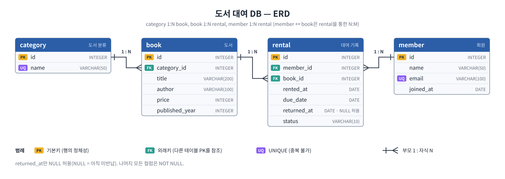
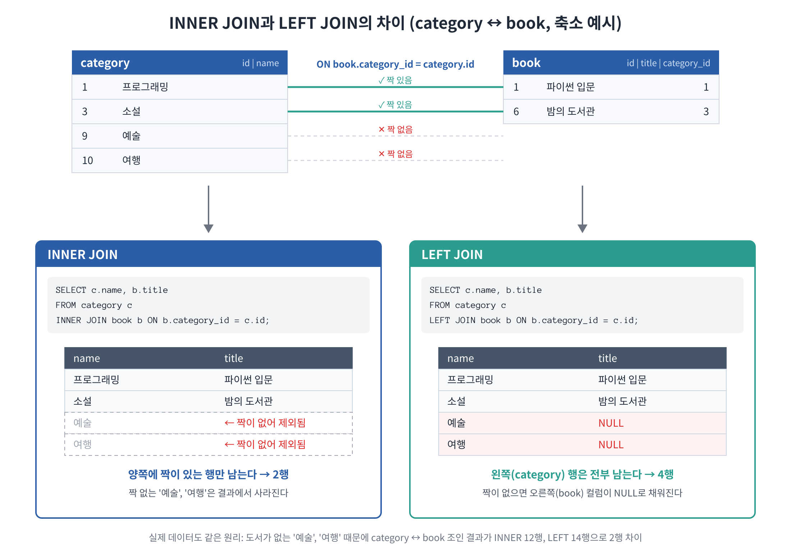

# 도서 대여 DB (SQLite)

## 실행 방법
`schema.sql` → `data.sql` → `queries.sql` 순서로 실행한다. 쿼리별 실행 결과는 `results/`에 있다.
SQLite는 FK 검사가 기본으로 꺼져 있으므로 접속할 때마다 `PRAGMA foreign_keys = ON;`을 실행해야 한다. 세 파일 모두 첫 줄에 넣어 두었다.

## 1. 테이블 구성

| 테이블 | PK | 역할 | FK |
|---|---|---|---|
| category | id | 도서 분류 | - |
| member | id | 대여하는 회원 | - |
| book | id | 도서 정보 | category_id → category.id |
| rental | id | 대여 1건의 기록 (누가, 어떤 책을, 언제) | member_id → member.id, book_id → book.id |

### ERD


### 1:N 관계와 그 이유
- **category 1:N book**: '프로그래밍' 분류에는 『파이썬 입문』, 『모던 C++ 프로그래밍』 등 여러 권이 속한다. 반대로 한 권은 분류 하나에만 속한다. 그래서 FK는 N쪽인 book에 둔다.
- **member 1:N rental**: 김민준 회원은 9월, 9월 말, 11월에 세 번 빌렸다. 대여 1건의 대여자는 항상 한 명이다.
- **book 1:N rental**: 『파이썬 입문』은 김민준 → 이서연 → 박도윤 → 정하준 순으로 네 번 대여됐다. 같은 책이 시간을 두고 여러 번 대여되지만, 대여 1건이 가리키는 책은 한 권이다.
- 결과적으로 member와 book은 **N:M** 관계이고, rental이 그 사이를 잇는 연결 테이블이다. 연결 테이블이 따로 있어서 대여일이나 반납일처럼 "관계 자체에 붙는 정보"를 저장할 수 있다.

## 2. 테이블을 이렇게 나눈 이유 (정규화)
- **1NF**: 모든 칸에 값이 하나씩만 들어간다. "빌린 책 목록"을 회원 칸에 쉼표로 이어 붙이지 않고, rental의 행 하나에 대여 1건을 기록한다.
- **2NF**: 모든 테이블의 PK가 단일 컬럼(id)이다. 그래서 PK의 일부에만 의존하는 컬럼이 생길 수 없다.
- **3NF**: book에는 카테고리 이름을 넣지 않고 category_id만 둔다. 이름까지 넣으면 book → category_id → name으로 이어지는 이행 종속이 생긴다. 그러면 이름 하나를 바꿀 때 해당 책의 모든 행을 고쳐야 한다. rental도 같은 원리로 회원 이름이나 책 제목을 복사해 두지 않고 id만 가진다.
- **의도적으로 남긴 중복**: `rental.status`는 엄밀히 따지면 `returned_at`과 `due_date`로 계산할 수 있는 값이다. 조회 쿼리를 단순하게 만들고 "연체 처리(UPDATE)" 요구사항을 실습하려고 남겼다. 대신 두 값이 서로 어긋날 위험이 있다. 반납 처리할 때 `returned_at`과 `status`를 반드시 함께 바꿔야 한다.

## 3. 컬럼 타입 선택 근거
| 컬럼 | 타입 | 이유 |
|---|---|---|
| id, *_id | INTEGER | 비교와 조인이 빠르다. SQLite에서 `INTEGER PRIMARY KEY`는 자동 증가한다 |
| price | INTEGER | 원 단위라 소수가 필요 없다. 부동소수점 오차도 피할 수 있다 |
| published_year | INTEGER | 연도만 비교하고 정렬한다 |
| joined_at, rented_at, due_date, returned_at | DATE | 시각 없이 날짜만 필요하다. SQLite는 DATE를 'YYYY-MM-DD' 문자열로 저장하는데, 이 형식은 사전순 정렬이 곧 날짜순이라 `<`, `>` 비교가 그대로 동작한다 |
| name, title, email, status | VARCHAR | 길이가 정해진 짧은 문자열이다. SQLite는 길이 제한을 강제하지 않지만, 다른 DB로 옮길 때를 생각해 표준 타입으로 적었다 |

## 4. 제약조건
- **NOT NULL**: 모든 필수 컬럼에 건다. `returned_at`만 예외로, 아직 반납하지 않았다는 뜻의 NULL을 허용한다.
- **UNIQUE**: `member.email`(회원 구분용), `category.name`(분류 중복 방지)
- **CHECK**: `price >= 0`. `status`는 'RENTED', 'RETURNED', 'OVERDUE' 세 값만 받는다.
- **FK 동작 확인**: 없는 회원(999)을 참조하는 대여를 INSERT하면 `FOREIGN KEY constraint failed` 오류로 막힌다(`results/fk_check.txt`). 해결 방법은 member에 해당 회원을 먼저 INSERT하거나 존재하는 member_id로 고치는 것이다.

## 5. 개념 정리

### DB와 엑셀의 차이
엑셀도 표를 여러 시트로 나눌 수는 있다. 하지만 시트 사이의 연결은 사람이 지켜야 하는 약속일 뿐이다. 회원 시트에서 행을 지워도 대여 시트에는 그 회원 번호가 그대로 남는다. 관계형 DB는 이 관계를 FK라는 **규칙으로 저장**한다. 그래서 없는 회원을 참조하는 입력이나, 대여 기록이 남아 있는 회원의 삭제를 DB가 직접 거부한다. NOT NULL, UNIQUE, CHECK도 같은 원리로 잘못된 값이 아예 들어오지 못하게 막는다. 즉 차이는 데이터 양이 아니라 **관계와 무결성을 누가 보장하느냐**에 있다.

### PK와 FK
- **PK(기본키)**: 테이블 안에서 한 행을 유일하게 식별하는 값이다. 행의 정체성에 해당한다. 중복과 NULL이 불가능하다.
- **FK(외래키)**: 다른 테이블의 PK를 가리키는 값이다. 두 행을 연결하는 역할을 한다. 반드시 실제로 존재하는 PK 값만 넣을 수 있다.
- 예: `rental.member_id = 1`은 "이 대여는 member 테이블에서 id가 1인 행(김민준)의 것"이라는 연결이다.

### INNER JOIN과 LEFT JOIN
- **INNER JOIN**: 양쪽 모두에 짝이 있는 행만 남긴다.
- **LEFT JOIN**: 왼쪽 테이블의 행은 모두 남긴다. 짝이 없으면 오른쪽 컬럼을 NULL로 채운다.
- 예: `category`와 `book`을 INNER JOIN하면 12행이 나온다. 도서가 없는 '예술', '여행'은 빠진다. LEFT JOIN하면 14행이 나오고, '예술'과 '여행' 행의 book 컬럼은 NULL이다.



- Q08은 이 NULL을 이용한다. LEFT JOIN 뒤에 `WHERE r.id IS NULL`을 걸면 "짝이 없는 행", 즉 한 번도 대여되지 않은 책만 남는다.

### GROUP BY와 집계 함수
- **GROUP BY**: 지정한 컬럼 값이 같은 행끼리 묶어서, 묶음 하나를 결과 한 행으로 만든다.
- **COUNT(컬럼)**: 묶음 안에서 그 컬럼이 NULL이 아닌 행의 수를 센다. **COUNT(\*)**는 NULL과 상관없이 행 수를 센다.
- **SUM / AVG**: 묶음 안 값의 합계와 평균을 구한다. NULL은 계산에서 제외된다.
- **WHERE와 HAVING**: WHERE는 묶기 전에 행을 거르고, HAVING은 묶은 뒤에 그룹을 거른다.

## 6. 복잡한 쿼리 분해: Q09 (회원별 대여 횟수)
```sql
SELECT m.name, COUNT(r.id) AS rental_count
FROM member m
LEFT JOIN rental r ON r.member_id = m.id
GROUP BY m.id, m.name
ORDER BY rental_count DESC, m.id;
```
1. **FROM member m**: 회원 10명에서 시작한다.
2. **LEFT JOIN rental**: 회원마다 대여 기록을 붙인다. 대여가 3번이면 행이 3개가 된다. 대여가 없는 장시우와 임하은은 rental 컬럼이 전부 NULL인 행 1개로 남는다. INNER JOIN을 쓰면 이 두 사람이 결과에서 사라진다.
3. **GROUP BY m.id, m.name**: 같은 회원의 행을 하나로 묶는다. 이름이 아니라 id로 묶는 이유는 동명이인이 있어도 섞이지 않게 하기 위해서다.
4. **COUNT(r.id)**: 묶음 안에서 r.id가 NULL이 아닌 행만 센다. 그래서 장시우는 0이 된다. 여기서 `COUNT(*)`를 쓰면 NULL로 채워진 행도 1개로 세어 **0이 아니라 1**이 나온다. 이 쿼리에서 가장 틀리기 쉬운 지점이다.
5. **ORDER BY rental_count DESC, m.id**: 대여가 많은 순으로 정렬한다. 횟수가 같으면 id 순으로 정렬해 결과 순서를 고정한다.

## 7. 인덱스
- **생성한 인덱스**: `idx_rental_member_id ON rental(member_id)`. 회원별 조회와 집계(Q05, Q09)에서 조인 조건으로 쓰인다. SQLite는 FK 컬럼에 인덱스를 자동으로 만들지 않는다. `EXPLAIN QUERY PLAN`으로 인덱스를 사용하는 것을 확인했다(Q15).
- **추가 후보**:
  - `rental(book_id)`: 도서별 대여 집계(Q08, Q11)에 쓰인다.
  - `rental(due_date)`: 연체 대상 검색(Q13)에 쓰인다.
  - `book(category_id)`: 카테고리별 집계(Q10)에 쓰인다.
- **비용**: 인덱스는 INSERT, UPDATE, DELETE 때마다 함께 갱신되고 저장 공간도 차지한다. 지금은 15행이라 효과가 거의 없다. 데이터가 많고, 쓰기보다 조회가 훨씬 많은 컬럼에 거는 것이 맞다.

## 8. 시행착오와 해결
| 문제 | 원인 | 해결 |
|---|---|---|
| FK를 걸었는데 없는 id를 넣어도 INSERT가 성공함 | SQLite는 FK 검사가 기본값 OFF | 각 SQL 파일 첫 줄에 `PRAGMA foreign_keys = ON;` 추가 |
| "최근 30일", "연체" 쿼리 결과가 실행하는 날마다 달라짐 | `date('now')`가 실행 시점 기준 | 기준일을 2026-11-24로 고정하고 표준 문자열 비교로 작성 |
| queries.sql을 두 번 실행하면 Q12, Q14 결과가 달라짐 | Q13 UPDATE와 Q14 DELETE가 데이터를 바꿈 | 다시 돌릴 때는 schema.sql부터 재실행하도록 파일 상단에 명시 |
| DROP TABLE 순서에 따라 오류 발생 가능 | 부모 테이블을 먼저 지우면 자식의 FK가 참조할 대상을 잃음 | rental → book → member → category 순으로 DROP |
| 실행 환경에 sqlite3 CLI가 설치돼 있지 않음 | - | Python 내장 `sqlite3` 모듈로 실행해 결과 텍스트를 저장 |
